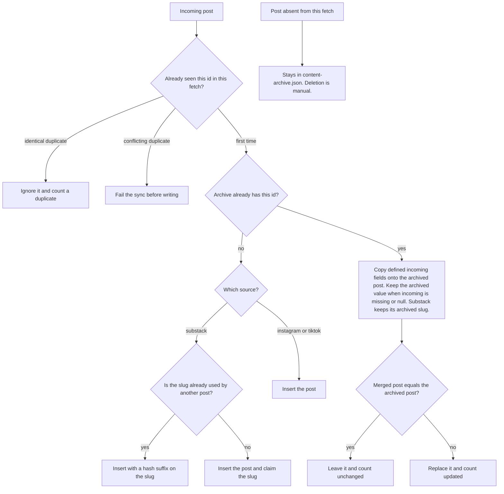

# Content archive pipeline

How [`src/data/content-archive.json`](../src/data/content-archive.json) is built, and how that build reaches the Netlify site.

Behold refreshes an Instagram feed of the **latest 6 posts once per day**. The Apify actor task scrapes TikTok **once every 2 days**. Those schedules live in Behold and Apify. This repo only reads their latest results. Substack posts come from Substack's [RSS feed](https://everywomanhealth.substack.com/feed) and don't have a separate service to collate content updates. The synchronizer is [`scripts/content/`](../scripts/content/).

## Pipeline

```mermaid
flowchart TD
  igAccount["Instagram everywoman.io"] --> beholdFeed["Behold feed URL, refreshed once per day, latest 6 posts"]
  ttAccount["TikTok @everywomanhealth"] --> apifyTask["Apify actor task everywoman~everywoman-tiktok, scrape every 2 days, latest 50 posts"]
  substackFeed["Substack RSS everywomanhealth.substack.com/feed"]

  cron["GitHub Actions cron 11:23 UTC daily, or workflow_dispatch"] --> checkout["Checkout the default branch"]
  checkout --> syncCmd["pnpm content:sync with Behold, Apify, and optional SUBSTACK_PROXY_TOKEN"]

  syncCmd --> validateEnv["Validate Behold and Apify secrets before any request"]
  validateEnv --> readArchive["Read src/data/content-archive.json"]
  readArchive --> fetchParallel["Fetch Behold, the Apify dataset, and Substack in parallel"]

  beholdFeed --> fetchParallel
  substackFeed --> directRss["Direct Substack GET, six browser profiles"]
  directRss -->|RSS| fetchParallel
  directRss -->|"403, 429, 5xx, timeout, or challenge"| proxyRss["POST Netlify substack-rss, six profiles, one upstream fetch each"]
  directRss -->|other 4xx| skipSubstack["Warn. Leave archived Substack posts unchanged."]
  proxyRss -->|RSS| fetchParallel
  proxyRss -->|"auth, config, or retries exhausted"| skipSubstack
  skipSubstack --> fetchParallel

  apifyTask --> lastRun["GET the latest SUCCEEDED run, then that run dataset"]
  lastRun --> datasetAge{"Dataset available, and how old?"}
  datasetAge -->|"3 days old or newer"| fetchParallel
  datasetAge -->|"older than 3 days, up to 7 days"| warnStale["Log a warning that a scheduled scrape may have been missed"]
  datasetAge -->|"missing, failed, empty, or older than 7 days"| failTikTok["Fail the TikTok fetch"]
  warnStale --> fetchParallel
  failTikTok --> abortSync["Stop before reconcile or write. Nothing is committed."]

  fetchParallel --> requiredFailed{"Did Instagram, TikTok, or Substack parsing fail?"}
  requiredFailed -->|yes| abortSync
  requiredFailed -->|no| reconcile["Reconcile in memory. See the merge diagram below."]

  reconcile --> dryRun{"Dry run?"}
  dryRun -->|yes| dryReport["Print added, updated, and missing-thumbnail counts. Skip writes and downloads."]
  dryRun -->|no| writeIfChanged{"Did the serialized archive change?"}
  writeIfChanged -->|yes| atomicWrite["Atomically write src/data/content-archive.json"]
  writeIfChanged -->|no| tiktokThumbs{"Any TikTok post missing metadata.thumbnailPath?"}
  atomicWrite --> tiktokThumbs

  tiktokThumbs -->|yes| oembed["GET www.tiktok.com/oembed, then download thumbnail_url"]
  tiktokThumbs -->|no| igThumbs{"Any post from this Behold fetch missing thumbnailPath with a cover URL?"}

  oembed -->|"JPEG, PNG, or WebP, at most 8 MB"| saveThumb["Save public/tiktok/sourceId.ext, set thumbnailPath, and rewrite the archive"]
  oembed -->|"request, type, or size failure"| thumbFail["Warn, leave that post without thumbnailPath, and continue"]
  saveThumb --> igThumbs
  thumbFail --> igThumbs

  igThumbs -->|yes| igCover["Download sizes, then thumbnailUrl, then an image mediaUrl. No oEmbed hop."]
  igThumbs -->|no| noThumbWork["Leave saved thumbnails in place, including when a provider rotates the signed URL"]

  igCover -->|"JPEG, PNG, or WebP, at most 8 MB"| saveIg["Save public/instagram/sourceId.ext, set thumbnailPath, and rewrite the archive"]
  igCover -->|"request, type, or size failure"| igFail["Warn, leave that post without thumbnailPath, and continue"]

  saveIg --> stageFiles["Stage src/data/content-archive.json, public/tiktok, and public/instagram"]
  noThumbWork --> stageFiles
  igFail --> stageFiles
  thumbFail --> logoFallback["TikTok getPostThumbnail serves src/imports/logo-full.png until a later sync saves a file"]
  igFail --> igRemote["Instagram getPostThumbnail keeps the remote cover until a local file is saved"]

  stageFiles --> hasDiff{"Staged diff empty?"}
  hasDiff -->|yes| noCommit["No commit and no push. The Netlify hook is not called."]
  hasDiff -->|no| commitPush["Commit [AUTO] sync external posts as github-actions[bot] and push the default branch"]

  commitPush --> hook["POST the NETLIFY_BUILD_HOOK secret"]
  commitPush --> gitPush["Netlify also receives the Git push"]
  gitPush --> ignoreBot["netlify.toml ignore exits 0 and skips that Git build"]
  hook --> netlify["Netlify production build of the default branch, started by the build hook"]
  netlify --> viteBuild["pnpm build imports the archive. public/tiktok and public/instagram are copied into dist."]
```

The GitHub Action is [`.github/workflows/sync-content.yml`](../.github/workflows/sync-content.yml). It commits with `github-actions[bot]` and the message `[AUTO] sync external posts` only when the archive JSON, `public/tiktok/`, or `public/instagram/` changed, then pushes the default branch. After that push succeeds, a second job POSTs to the `NETLIFY_BUILD_HOOK` repository secret. That secret is the bare build-hook URL from Netlify, created for the production branch (`main`). The synchronizer does not read it, and a local `pnpm content:sync` does not call it.

Instagram covers come from the post Behold already returned. The downloader uses `sizes.medium`, then `small`, `large`, and `full`, then `thumbnailUrl`, then an image `mediaUrl`. An `.mp4` `mediaUrl` is skipped. A carousel uses the album media first, then the first child that has one of those URLs. `thumbnailUrl` is only present on videos and points at Instagram's CDN, so it is not the first choice. Only posts in the current Behold response are downloaded. Posts that have left the latest 6 stay in the archive and are not requested again, because Behold no longer serves those images. A failure for a post still in the feed warns and retries on a later sync while that post remains in the feed. A saved `thumbnailPath` is kept when Behold rotates the remote URL.

Substack requests use six fixed browser header profiles instead of the synchronizer user agent. `Accept-Encoding` is left unset so Node's `fetch` can decompress the body. The direct fetch runs immediately, then retries after 1, 5, 10, 30, and 60 seconds. HTTP 403, 429, 5xx, timeouts, network failures, and HTML challenge pages are retried. `Retry-After` on a 429 or 503 can lengthen that wait up to 60 seconds. Any other 4xx stops the direct phase without calling the proxy. When the retryable failures are exhausted, the sync POSTs `https://everywoman.io/.netlify/functions/substack-rss?profile=0` through `profile=5` with `Authorization: Bearer $SUBSTACK_PROXY_TOKEN`, on the same schedule. [`netlify/functions/substack-rss.ts`](../netlify/functions/substack-rss.ts) checks that bearer token and fetches the fixed Substack URL once. It does not sleep or retry. Each profile index selects a header set stored in the repository. Caller-supplied URLs and headers are ignored. If `SUBSTACK_PROXY_TOKEN` is unset, the proxy phase is skipped and logged.

An unavailable Substack fetch logs `Substack was unavailable. Archived Substack posts were left unchanged.`, emits a GitHub Actions `::warning::`, and appends that sentence to the step summary. It is not recorded as a successful fetch of zero posts. Archived Substack posts, slugs, and bodies stay as they are. Instagram and TikTok still reconcile, and a changed archive is still committed and deployed through the existing build hook. A real RSS document that fails article validation still aborts the run before writing, as do Instagram and TikTok failures.

Generate the proxy token with `openssl rand -base64 32` and do not commit it. Store the same value as the GitHub Actions secret `SUBSTACK_PROXY_TOKEN` and as a Netlify production environment variable named `SUBSTACK_PROXY_TOKEN`, marked secret and available to Functions. Merge the function in a human commit so Netlify deploys it, set the Netlify variable, redeploy if that variable was added after the deploy, then set the GitHub secret. CI does not receive the token. Local `pnpm content:sync` does not need it when the direct feed succeeds. Set it in `.env`, and optionally `SUBSTACK_PROXY_URL`, only to call the proxy. After deploy, `POST` the function without a token and confirm the body is 401 JSON. If the response is the site HTML 404 page, `public/_redirects` is shadowing `/.netlify/functions/*`; add a more specific rewrite above the splat and redeploy. The `netlify.toml` ignore rule is unchanged, so a later `github-actions[bot]` archive commit still skips the duplicate Git-triggered build.

Netlify still builds ordinary pushes through its Git connection. [`netlify.toml`](../netlify.toml) tells Netlify to skip the Git-triggered build when the commit author is `github-actions[bot]`, so a content-sync push is not built twice. The ignore command does not cancel a build started by the hook. A sync that exits early, a dry run, or a run with an empty diff does not commit and does not call the hook, so the live site stays as it is. If the hook POST fails after the push, re-run the failed job; re-running the whole workflow usually finds no new diff and will not call the hook again.

## Merge into the archive

Reconciliation in [`scripts/content/reconcile.ts`](../scripts/content/reconcile.ts) matches on `id`, which is `source:sourceId`. The archive is append-only: posts that fall out of a feed stay until someone deletes them by hand. A failed Substack fetch contributes no incoming Substack posts, so those archived records stay unchanged while other providers are still merged. A successful Substack response with zero items is different: the fetch counts as successful, and the same append-only rule keeps older posts.

After reconcile, posts are sorted by `publishedAt` descending, then by `id`. The archive file is rewritten only when that serialized JSON differs from the file on disk.
